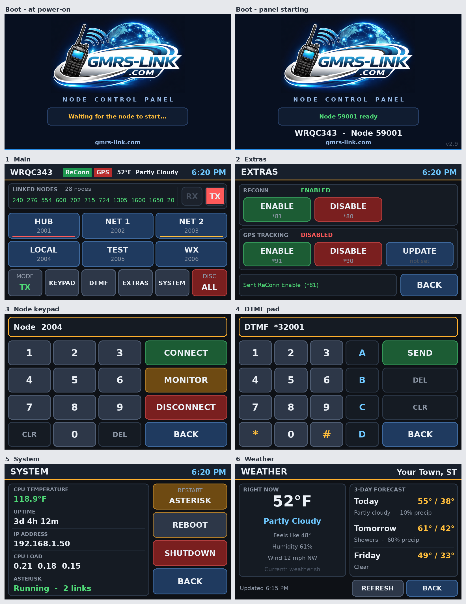

# GMRS-Link Nextion Node Control Panel

A 5" Nextion touchscreen control panel for HamVOIP / AllStar nodes on a Raspberry Pi.
Connect and disconnect nodes, send DTMF, watch who's linked, and check your node at a
glance, without a computer.

**By [gmrs-link.com](https://gmrs-link.com)**



## Features

- **Main screen:** six quick-connect buttons, a scrolling list of linked nodes with a count, big RX/TX lights, weather and clock
- **Node keypad:** connect, monitor or disconnect any node number
- **DTMF pad:** 0-9, *, #, A-D, sent exactly as if keyed from a radio
- **Extras:** ReConn Enable/Disable and GPS Tracking Enable/Disable/Update, with green/red status badges
- **System:** CPU temperature, uptime, IP address, load and Asterisk status, plus Restart Asterisk, Reboot and Shutdown
- **Weather:** the same weather as Supermon, plus a 3-day forecast
- Screen saver, wake on touch, and a GMRS-Link boot screen while the node starts

## What you need

- A Raspberry Pi running **HamVOIP**
- A **5" or 7" Nextion display (800x480)** already loaded with the GMRS-Link screen file.
  The screen file is provided by gmrs-link.com. You don't need Nextion Editor.
- **One of these** to connect it safely (see below):
  - a **USB-to-TTL serial adapter** (CP2102 or CH340), recommended, or
  - **two resistors**, 1 kΩ and 2 kΩ (or three 1 kΩ), to wire it to the Pi's GPIO pins
- Jumper wires
- An internet connection on the node

## 1. Wire the screen to the Pi

Shut down the node and unplug it first.

> **Important:** Nextion **Intelligent** screens (model numbers with a **P**, like
> NX8048**P**050 and NX8048**P**070) send **5 V** on their TX wire. The Pi's pins only take
> **3.3 V**, so **never connect the yellow TX wire straight to the Pi**. Use option A or B.

### Option A - USB-to-TTL adapter (recommended, no soldering)

| Nextion wire | Connect to |
|---|---|
| Red (+5V) | Pi **pin 4** (5V) |
| Black (GND) | Pi **pin 6** (Ground) |
| Yellow (TX) | Adapter **RXD** |
| Blue (RX) | Adapter **TXD** |

Plug the adapter into a USB port on the Pi. Leave the adapter's 5V/3.3V/VCC pin
unconnected. The screen gets its power from the Pi, and the adapter only carries the data.
In the installer, choose **1) USB-to-TTL adapter**.

### Option B - Pi GPIO pins with two resistors

| Nextion wire | Connect to |
|---|---|
| Red (+5V) | Pi **pin 4** (5V) |
| Black (GND) | Pi **pin 6** (Ground) |
| Blue (RX) | Pi **pin 8** (TXD), direct |
| Yellow (TX) | **1 kΩ resistor** → Pi **pin 10** (RXD) |
| | **2 kΩ resistor** from Pi **pin 10** to Pi **pin 9** (Ground) |

The two resistors drop the screen's 5 V signal to about 3.3 V. Two 1 kΩ resistors in
series make the 2 kΩ. In the installer, choose **2) Pi GPIO pins 8 and 10**.

```
Nextion yellow (TX) ---[ 1k ]---+--- Pi pin 10 (RXD)
                                |
                              [ 2k ]
                                |
                              Pi pin 9 (GND)
```

Pin 1 is the corner pin nearest the SD card. Even pins (2, 4, 6, 8, 10) are on the
row along the edge of the board; odd pins (1, 3, 5, 7, 9) are on the inner row.

> Screens without a P in the model number (Basic NX8048**T**050, Enhanced NX8048**K**050)
> send 3.3 V and can go straight to pins 8 and 10 with no resistors.

> **Some Nextion cables have the yellow and blue colors swapped.** If the screen stays on
> "Waiting for the node to start..." after installing, check which wire comes from the
> screen's **TX** pin (it's labeled on the back of the screen) and make sure that one goes
> to the adapter's RXD, or through the resistor to pin 10.

### Power

The 5" draws up to about 0.4 A and the 7" up to about 0.5 A. Use a good Pi power supply
(2.5 A or more for a Pi 3, 3 A for a Pi 4), or power the screen from its own 5 V, 1 A
supply with its ground joined to the Pi's ground.

Power the node back on. The screen shows the GMRS-Link boot screen right away.

## 2. Install

Log in to the node with SSH (PuTTY, **port 222**, user **root**). If the HamVOIP menu
appears, choose the option to exit to the shell. Then paste this one line:

```
curl -sSL https://raw.githubusercontent.com/__GITHUB_REPO__/main/get.sh | bash
```

The installer asks a few questions. The value in [brackets] is used if you press Enter.

| Question | Default |
|---|---|
| Your node number | |
| Header text, e.g. your call sign | NODE &lt;your node&gt; |
| How is the screen connected? (1 = USB adapter, 2 = GPIO pins with resistors) | 1 |
| Minutes before the screen saver (0 = never) | 10 |
| Turn the screen on when someone keys up? | y (answer n on a busy hub) |
| Brightness, 10-100 | 100 |
| Use a 24-hour clock? | n |
| Button 1-6 node number and label | Enter leaves a button empty |
| ZIP code for weather (- = no weather) | |
| Units, F or C | F |
| ReConn / GPS Tracking DTMF codes | *917, *918, *A50, *A51, *A52 |
| Show the ReConn badge? / Show the GPS badge? | y |

The first time, it switches on the Pi's serial port and asks you to **reboot**. After the
reboot, the screen fills in by itself within a minute.

## Update

Run the same line again and choose **1) Update**. Your settings are kept.

```
curl -sSL https://raw.githubusercontent.com/__GITHUB_REPO__/main/get.sh | bash
```

## Change your settings

Run the same line and choose **2**, or:

```
cd /root/nextion-hamvoip
bash install.sh
```

Choose **2) Keep my settings** to change only the weather, Extras codes and badges, or
**1) Start fresh** to answer everything again. Or edit `/etc/nextion-node.json` and run
`systemctl restart nextion-node`.

## Uninstall

```
cd /root/nextion-hamvoip
bash install.sh uninstall
```

## Troubleshooting

See what the panel is doing:

```
journalctl -u nextion-node -f --no-pager
```

| Problem | Fix |
|---|---|
| Screen stays on "Waiting for the node to start..." | Check the screen's TX wire goes to the adapter's RXD (or through the 1 kΩ to pin 10) and its RX wire to the adapter's TXD (or pin 8). Make sure you rebooted after installing (GPIO), and that you picked the right connection in the installer. |
| Screen completely dark | Check red is on pin 4 and black on pin 6. |
| "Asterisk not responding" | Run `asterisk -rx "rpt nodes <your node>"` to check Asterisk is running. |
| No weather | Normal for a minute or two after a reboot. If it stays empty, run `python3 /usr/local/sbin/nextion_node.py --weather-test` |
| GPS badge red after a reboot | `/tmp` is cleared at boot, so it stays red until GPS Tracking is enabled again. |
| Screen won't go dark | With "turn on when someone keys up" set to y, every transmission restarts the timer. Rerun the installer and answer n. |

## Credits

Created by **[gmrs-link.com](https://gmrs-link.com)**. Please keep this credit if you share it.
